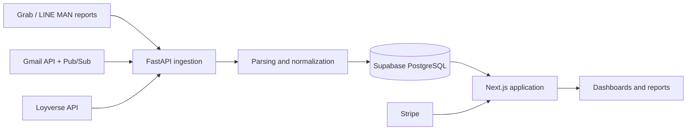

# Restaurant Finance Automation

[](https://github.com/OhmSaharath/restaurant-finance-automation/actions/workflows/ci.yml)

A production web application for reconciling restaurant delivery settlements, tracking costs, and reviewing daily profit across branches and sales channels.

**Live product:** [fatcat.stream](https://fatcat.stream)

> The live instance contains private business data and does not provide public demo credentials. This repository excludes production exports, credentials, and tenant data.

## Why this project exists

Restaurant delivery platforms provide settlement information in different PDF, CSV, and spreadsheet formats. Comparing gross sales, platform deductions, net payouts, menu performance, and food costs manually became repetitive and error-prone.

This system was built for real restaurant operations. It brings those sources into one tenant-scoped workflow so the owner can review the numbers from a dashboard instead of rebuilding reports every day.

## Product capabilities

- Import and parse Grab settlement PDFs and delivery-platform CSV/XLSX reports.
- Receive settlement attachments through Gmail OAuth and Google Pub/Sub push notifications.
- Sync in-store sales and item costs from Loyverse.
- Normalize branch and menu identities across inconsistent platform reports.
- Reconcile sales, commissions, deductions, and net payouts.
- Calculate daily P&L, menu-level sales, COGS, and BOM-based costs.
- Present branch, menu, reconciliation, audit, and billing views.
- Isolate data by brand and user membership with Supabase Auth and Row Level Security.
- Manage subscription state through Stripe.

## Architecture



The frontend and backend are deployed independently:

- Next.js frontend: Vercel
- FastAPI backend: Docker on Google Cloud Run
- Database and authentication: Supabase

See [docs/architecture.md](docs/architecture.md) for a more detailed component map.

## Technology stack

### Web

- Next.js 15, React 19, and TypeScript
- Tailwind CSS, Recharts, Framer Motion, and Radix UI
- Supabase JavaScript and SSR clients

### API and data processing

- Python 3.12, FastAPI, Uvicorn, and Pydantic
- pandas, NumPy, OpenPyXL, and pdfplumber
- Gmail API, Google OAuth/OIDC, Pub/Sub, Loyverse API, and Stripe

### Data and infrastructure

- Supabase PostgreSQL, Auth, Storage, and Row Level Security
- Docker, Google Cloud Run, Cloud Scheduler, and Vercel

## Repository structure

```text
app/                  FastAPI routes, ingestion, parsers, and domain logic
web/                  Next.js application and server-side route handlers
supabase/migrations/  Supabase schema and RLS migration history
db/                   Supporting SQL definitions
migrations/           Earlier schema snapshots retained for reference
schemas/               Shared Python models
scripts/               Explicit maintenance and backfill utilities
tests/                 Unit and regression tests
```

## Local development

### 1. Environment configuration

Copy the sanitized template for the backend and Next.js server runtime:

```sh
cp .env.example .env
cp .env.example web/.env.local
```

Replace every placeholder with development credentials. Never expose `SUPABASE_SERVICE_ROLE_KEY`, OAuth secrets, Stripe secrets, or `ENCRYPTION_KEY` through a `NEXT_PUBLIC_*` variable.

### 2. Backend

```sh
python3 -m venv .venv
source .venv/bin/activate
pip install -r requirements.txt
uvicorn app.main:app --host 0.0.0.0 --port 8080 --reload
```

### 3. Frontend

```sh
cd web
npm ci
npm run dev
```

The frontend runs on `http://localhost:3005` and the API on `http://localhost:8080`.

### 4. Database

Apply the migrations to a disposable Supabase project first. The migration directory reflects the evolution of the production system and should be consolidated and verified before using it to bootstrap a new production environment.

## Verification

```sh
pip install -r requirements-dev.txt
python -m pytest
cd web && npm run build
```

Some integration paths require external development credentials and are intentionally not exercised by the unit suite.

## Data and security notes

- Real settlement PDFs, CSV/XLSX exports, local environment files, and deployment metadata are excluded from this repository.
- Server-only Supabase and integration credentials must remain outside the browser bundle.
- Public-schema tables use tenant-aware Row Level Security policies; privileged operations are handled by server-side clients.
- Maintenance scripts can read or update production data and should only be run deliberately with the correct environment.

## Project background

I built and operated this system for my own restaurant after encountering the reporting problem directly. I defined the workflows, validated outputs against real settlements, and used AI-assisted development tools to accelerate implementation while keeping business rules and production verification grounded in actual operations.

This repository is published as a portfolio project. It is not financial, accounting, or tax advice and is not distributed as a turnkey accounting product.
